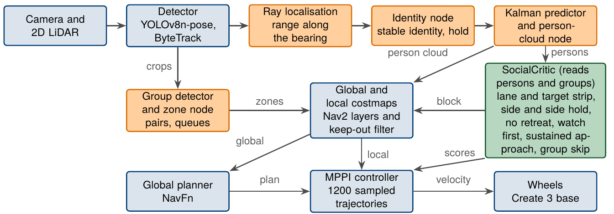
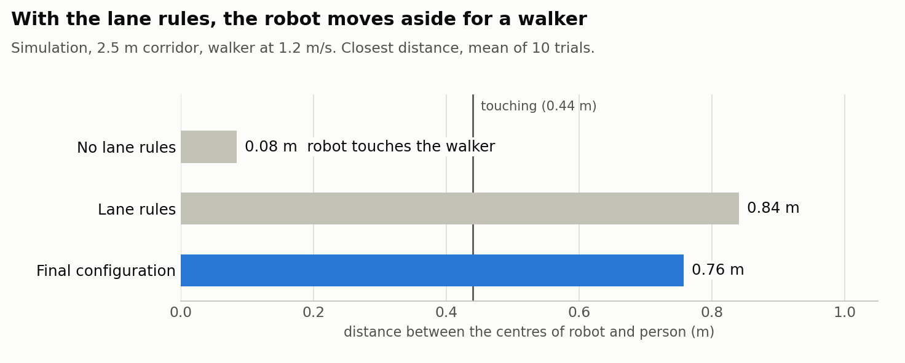
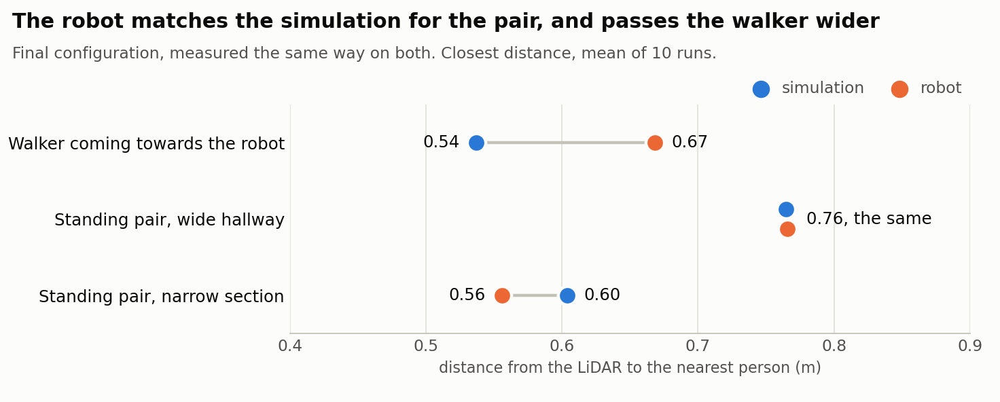

# Social Navigation for TurtleBot 4 (ROS 2 Jazzy, simulation)

Simulation code of the master's thesis *Lightweight Socially-Aware Navigation via Human Motion Prediction and Scene Understanding* (Deggendorf Institute of Technology, Campus Cham, 2026).

A TurtleBot 4 detects people with its camera and LiDAR, predicts their motion with a Kalman filter, and passes them at a social distance. Nav2's MPPI controller uses a custom critic, the SocialCritic, with lane rules for a person walking towards the robot, and a group detector tells the robot whether to go around a standing pair or pass between its members. The same system runs on the physical robot; see the [robot repository](https://github.com/Brian-Lim-Tze-Zhen/Turtlebot4-Hardware-Humble).

**Contents:** [Results](#results) · [Pipeline](#pipeline) · [Analysis](#analysis) · [Quick start](#quick-start) · [Documentation](#documentation) · [References](#references) · [Citation](#citation)

## Results

### Head-on walker: the robot moves aside early


*2.5 m corridor, walker at 1.2 m/s, played at 2x speed. A demonstration run of 4 October 2026 with the lane rules: the robot passes on the right at 0.74 m between centres without stopping.*

Ten trials per configuration ([reports](ros2_ws/analysis/)). The target is 0.8 m between the centres of robot and person.

| Configuration | Closest distance between centres (m) | Stopped (s) | Time to goal (s) | Goal reached |
|---|---|---|---|---|
| Baseline: person cloud, no lane rules | 0.08 ± 0.07 (contact) | 2.4 ± 2.5 | 42.8 ± 1.6 | 10 / 10 |
| Lane rules | 0.84 ± 0.04 | 0.0 | 37.3 ± 0.4 | 10 / 10 |
| Final configuration (as on the robot) | 0.76 ± 0.07 | 0.0 | 37.7 ± 0.4 | 10 / 10 |

### Standing pair: around in open space, between in a narrow corridor


*Played at 2x speed. Left: in open space the robot goes around the pair. Right: in a 2.0 m corridor there is no way around, so it passes between the two people without stopping. Demonstration runs of 4 October 2026, not trials of the table.*

Final configuration, ten trials each ([report](ros2_ws/analysis/conv_F_rec20gs_n10_report.txt)):

| Case | Robot's path | Closest distance between centres (m) | Stopped (s) | Time to goal (s) | Goal reached |
|---|---|---|---|---|---|
| Wide (open space) | around the pair | 0.87 ± 0.03 | 0.0 | 24.6 ± 0.2 | 10 / 10 |
| Narrow (2.0 m corridor) | between the members | 0.71 ± 0.02 | 0.0 | 21.4 ± 0.2 | 10 / 10 |

### On the real robot

The final configuration was also run on the physical TurtleBot 4, ten runs per case (thesis Section 7.6.2). The robot passed the head-on walker on the right in all ten runs, and went around the pair in the wide hallway and between the members in the narrow section in all ten, without stopping for the pair. Distances, run commands and run records are in the [robot repository](https://github.com/Brian-Lim-Tze-Zhen/Turtlebot4-Hardware-Humble).

To repeat any of these runs, see [the experiments of the thesis](HOW_TO_RUN.md#4-the-experiments-of-the-thesis).

## Pipeline



*The final configuration from the camera to the wheels (thesis Figure 5.2). Blue: existing components (sensors, detector, tracker, Nav2 and the base); orange: nodes developed in the thesis; green: the SocialCritic with the lane rules. The labelled arrows into the costmaps carry what these nodes write into them. The simulation runs the same configuration with simulation copies of the nodes, which read raw camera images and use no `/turtlebot4` namespace. The [ROS topics between the nodes](docs/CONFIGURATIONS.md#topics-of-the-final-configuration) and the [simulation and robot files side by side](docs/CONFIGURATIONS.md#simulation-vs-robot) are listed separately.*

## Analysis

**What the lane rules change.** A person walks straight at the robot in a narrow corridor. Without the lane rules, the robot does not get out of the way in time, and they touch. With them, it moves to one side early and passes at about the target distance of 0.8 m.

<picture>
  <source media="(prefers-color-scheme: dark)" srcset="docs/media/headon_dark.png">
  
</picture>

**Does the real robot behave like the simulation?** The robot has no exact positions of people, so here both are measured the same way: the distance from the LiDAR to the nearest person. For the standing pair, robot and simulation agree. The robot passed the walker wider, and its runs varied more (± 0.15 m on the robot, ± 0.07 m in simulation).

<picture>
  <source media="(prefers-color-scheme: dark)" srcset="docs/media/sim_vs_robot_dark.png">
  
</picture>

*Data: the [simulation reports](ros2_ws/analysis/) and the [robot runs of 12 October 2026](https://github.com/Brian-Lim-Tze-Zhen/Turtlebot4-Hardware-Humble/blob/main/humble_client/Task/HARDWARE_DAY_20261012.md); [chart script](docs/media/make_results_chart.py).*

## Quick start

You need Linux with Docker and Docker Compose, and an X11 display. The default set-up is for Intel/Mesa graphics; for an NVIDIA GPU, see step 2.

**1. Get the code.** This downloads the repository: the workspace with the nodes, configurations, worlds and maps (`ros2_ws`), and the Docker set-up (`docker`).

```bash
git clone https://github.com/Brian-Lim-Tze-Zhen/Turtlebot4-Social-Navigation-Jazzy-Simulation-.git
cd Turtlebot4-Social-Navigation-Jazzy-Simulation-/docker
```

**2. Build and start the container.** The build installs ROS 2 Jazzy, Nav2, Gazebo Harmonic, the TurtleBot 4 packages and the Python environment for YOLO. It is needed once; later starts reuse the image. `up -d` starts the container `thesis_social_nav` in the background, with the workspace mounted from `ros2_ws`, so edits on the host are seen inside it at once. `xhost` lets Gazebo, RViz and the YOLO window open on your screen.

```bash
docker compose build
docker compose up -d
xhost +local:root
```

With an NVIDIA GPU (needs the NVIDIA Container Toolkit), use `docker compose -f docker-compose.nvidia.yaml build` and `docker compose -f docker-compose.nvidia.yaml up -d` instead. After a reboot, run `docker start thesis_social_nav` and `xhost +local:root` again.

**3. Open a shell in the container and build the workspace.** `colcon build` compiles the SocialCritic plugin and installs the perception package; `--symlink-install` links the Python nodes and launch files, so editing them needs no rebuild. Sourcing `install/setup.bash` makes the built packages visible in this shell.

```bash
docker exec -it thesis_social_nav bash
cd /root/thesis_social_navigation_ws
source /opt/ros/jazzy/setup.bash
colcon build --symlink-install
source install/setup.bash
```

**4. Run a scenario with one command.** Each run starts a fresh Gazebo, Nav2 and the perception pipeline, localises and undocks the robot, sends the goal (and starts the walkers), records a bag, shuts everything down and prints a short result. A run takes 2 to 4 minutes; the first one also downloads the YOLO weights.

```bash
./run_scenario.sh headon        # or headon_blocked, conversation_wide, conversation_narrow, queue
```

What each scenario shows and what to look for is in the [demo scenarios](SCENARIOS.md). To start each part yourself instead, one node per terminal with the pose and goal set by hand in RViz, run the [scenarios step by step](docs/MANUAL_RUN.md). (`./run_sim.sh` starts the [first pipeline](ros2_ws/src/social_perception/social_perception/README.md) of the project, not the one behind the results.)

## Documentation

In the order a new reader needs them:

| Document | What it holds |
|---|---|
| [Demo scenarios](SCENARIOS.md) | the five demo scenarios, what to look for, and what to do when a run fails |
| [Scenarios step by step](docs/MANUAL_RUN.md) | the same scenarios one node per terminal, with the pose and goal set by hand in RViz, for debugging |
| [Configurations](docs/CONFIGURATIONS.md) | what the parts of the long configuration names mean, which configuration each run uses, the ROS topics, and the simulation and robot files side by side |
| [How to run the experiments](HOW_TO_RUN.md) | folder map, set-up, and the command, recordings and report of every simulation experiment of the thesis |
| [Development notes](docs/DEVELOPMENT_NOTES.md) | how the scenarios were built and tuned, with the runs of 24 September to 4 October 2026 |
| [Container notes](docker/notes/) | fixes for problems of the container: TF recording, YOLO threads, custom Gazebo worlds, package pins |
| [Robot repository](https://github.com/Brian-Lim-Tze-Zhen/Turtlebot4-Hardware-Humble) | the robot side: final robot configuration, launch and run scripts, results on the robot |

## References

This work builds on [ROS 2](https://docs.ros.org/), [Nav2](https://github.com/ros-navigation/navigation2) and its [MPPI controller](https://github.com/ros-navigation/navigation2/tree/main/nav2_mppi_controller), the [nonpersistent voxel layer](https://github.com/SteveMacenski/nonpersistent_voxel_layer), the [TurtleBot 4 packages](https://github.com/turtlebot/turtlebot4), [Ultralytics YOLOv8](https://github.com/ultralytics/ultralytics), [ByteTrack](https://github.com/ifzhang/ByteTrack), [OpenVINO](https://github.com/openvinotoolkit/openvino) and [Gazebo](https://gazebosim.org/). It includes the `person_standing` model of Marina Kollmitz and copies of a few launch files. Authors, licenses and the matching references of the thesis: [credits and licenses](CREDITS.md).

## Citation

If you use this work, please cite the thesis:

```bibtex
@mastersthesis{limtzezhen2026socialnav,
  author = {{Brian Lim Tze Zhen}},
  title  = {Lightweight Socially-Aware Navigation via Human Motion Prediction and Scene Understanding},
  school = {Deggendorf Institute of Technology, Campus Cham},
  type   = {Master's thesis (M.Eng.)},
  year   = {2026}
}
```
