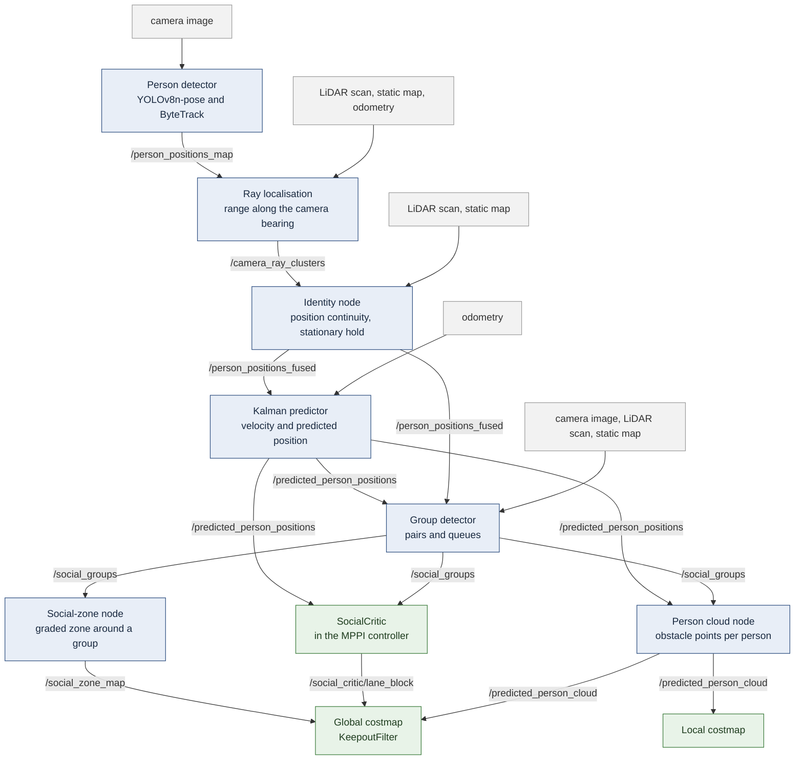

# Social Navigation for TurtleBot 4 (ROS 2 Jazzy, simulation)

Simulation code of the master's thesis *Lightweight Socially-Aware Navigation via Human Motion Prediction and Scene Understanding* (Deggendorf Institute of Technology, Campus Cham, 2026).

A TurtleBot 4 detects people with its camera and LiDAR (YOLO and ByteTrack), predicts their motion with a Kalman filter, and passes them at a social distance. Nav2's MPPI controller uses a custom critic (SocialCritic) with lane rules for a person walking towards the robot, and a group detector that tells the robot whether to go around a standing pair or pass between its members.

The same system on the physical TurtleBot 4 (ROS 2 Humble) is in the companion repository [Turtlebot4-Hardware-Humble](https://github.com/Brian-Lim-Tze-Zhen/Turtlebot4-Hardware-Humble).

## How it works



*Final configuration, the same in simulation and on the robot. Blue: perception and group nodes, with the topics between them; grey: their inputs; green: the navigation stack. The SocialCritic reads only the predicted positions, which carry velocity, and the groups, so that members of a standing group get no lane. The groups also reach the zone node, whose mask the global costmap's KeepoutFilter applies, and the person cloud node, which leaves group members to the zone. The SocialCritic's lane block steers the global plan to one side. The simulation runs `_sim` copies of the nodes, which read raw camera images and use no `/turtlebot4` namespace; the files are listed side by side in [docs/CONFIGURATIONS.md](docs/CONFIGURATIONS.md). Thesis Figure 3.5 shows the perception chain only, and with `/person_positions_fused` as an input of the SocialCritic, which the final configuration no longer has.*

## Results

### Head-on walker: the robot moves aside early


*Simulation, 2.5 m corridor, walker at 1.2 m/s, played at 2x speed. This is a demonstration run of 4 October 2026 with the lane rules; the robot passed on the right at 0.74 m between centres without stopping.*

Ten trials per configuration (`ros2_ws/analysis/*_n10_report.txt`). The target is 0.8 m between the centres of robot and person.

| Configuration | Closest distance between centres (m) | Stopped (s) | Time to goal (s) | Goal reached |
|---|---|---|---|---|
| Baseline: person cloud, no lane rules | 0.08 ± 0.07 (contact) | 2.4 ± 2.5 | 42.8 ± 1.6 | 10 / 10 |
| Lane rules | 0.84 ± 0.04 | 0.0 | 37.3 ± 0.4 | 10 / 10 |
| Final configuration (as on the robot) | 0.76 ± 0.07 | 0.0 | 37.7 ± 0.4 | 10 / 10 |

### Standing pair: around in open space, between in a narrow corridor


*Simulation, played at 2x speed. Left: in open space the robot goes around the pair. Right: in a 2.0 m corridor there is no way around, so it passes between the two people without stopping. Demonstration runs of 4 October 2026 (`demo_conversation_wide_20261004_132727`, `demo_conversation_narrow_20261004_132106`), not trials of the tables.*

Final configuration in simulation, ten trials each (`ros2_ws/analysis/conv_F_rec20gs_n10_report.txt`):

| Case | Robot's path | Closest distance between centres (m) | Stopped (s) | Time to goal (s) | Goal reached |
|---|---|---|---|---|---|
| Wide (open space) | around the pair | 0.87 ± 0.03 | 0.0 | 24.6 ± 0.2 | 10 / 10 |
| Narrow (2.0 m corridor) | between the members | 0.71 ± 0.02 | 0.0 | 21.4 ± 0.2 | 10 / 10 |

How to repeat these runs: [HOW_TO_RUN.md](HOW_TO_RUN.md), section 4.

### On the real robot

The final configuration was also run on the physical TurtleBot 4, ten runs per case (thesis Section 7.6.2): the robot passed the head-on walker on the right in all ten runs, went around the pair in the wide hallway and between the members in the narrow section in all ten, without stopping for the pair. Distances, run commands and run records are in the [hardware repository](https://github.com/Brian-Lim-Tze-Zhen/Turtlebot4-Hardware-Humble).

## Quick start

You need Linux with Docker and Docker Compose, an X11 display, and Intel/Mesa graphics. For an NVIDIA GPU, use `docker compose -f docker-compose.nvidia.yaml` in place of `docker compose` (needs the NVIDIA Container Toolkit).

```bash
git clone https://github.com/Brian-Lim-Tze-Zhen/Turtlebot4-Social-Navigation-Jazzy-Simulation-.git
cd Turtlebot4-Social-Navigation-Jazzy-Simulation-/docker
docker compose build && docker compose up -d
xhost +local:root

docker exec -it thesis_social_nav bash
cd /root/thesis_social_navigation_ws
source /opt/ros/jazzy/setup.bash
colcon build --symlink-install && source install/setup.bash
./run_scenario.sh headon        # or headon_blocked, conversation_wide, conversation_narrow, queue
```

To run a scenario step by step instead, one node per terminal with the pose and goal set by hand in RViz, follow [docs/MANUAL_RUN.md](docs/MANUAL_RUN.md). (`./run_sim.sh` starts the first pipeline of the project, not the one behind the results; see `ros2_ws/src/social_perception/social_perception/README.md`.)

The image installs ROS 2 Jazzy, Nav2, Gazebo Harmonic and the TurtleBot 4 packages; the YOLO weights are downloaded on first use.

## Documentation

In the order a new reader needs them:

| File | What it holds |
|---|---|
| [SCENARIOS.md](SCENARIOS.md) | the five demo scenarios, what to look for, and what to do when a run fails |
| [docs/MANUAL_RUN.md](docs/MANUAL_RUN.md) | the same scenarios step by step, one node per terminal, with the pose and goal set by hand in RViz (for debugging) |
| [docs/CONFIGURATIONS.md](docs/CONFIGURATIONS.md) | what the parts of the long configuration names mean, which configuration each run uses, and what differs between the simulation and the robot |
| [HOW_TO_RUN.md](HOW_TO_RUN.md) | folder map, set-up, and the command, recordings and report of every simulation experiment of the thesis |
| [docs/DEVELOPMENT_NOTES.md](docs/DEVELOPMENT_NOTES.md) | how the scenarios were built and tuned, with the runs of 24 September to 4 October 2026 |
| [Turtlebot4-Hardware-Humble](https://github.com/Brian-Lim-Tze-Zhen/Turtlebot4-Hardware-Humble) | the robot side: final robot configuration, launch and run scripts, results on the robot |
| [docker/notes/](docker/notes/) | fixes for problems of the container (TF QoS, YOLO threads, world sync, package pins) |

## Custom Gazebo worlds/models - known issue and workaround

`turtlebot4_gz_bringup`'s launch file does not reliably resolve
`model://` URIs via `GZ_SIM_RESOURCE_PATH` for nested custom models when
Gazebo is spawned through `ros2 launch` (confirmed empirically: works for
a standalone `gz sim` call, fails under `ros2 launch` with the identical
environment). `docker/setup_gazebo_worlds.sh` works around this by
copying custom worlds/models into `turtlebot4_gz_bringup`'s own installed
`worlds/` directory at container startup, and is also called explicitly
at the top of `run_sim.sh` for non-interactive invocations.

## Attribution

The `person_standing` Gazebo model (`ros2_ws/simulation_models/`) was
created by **Marina Kollmitz** (University of Freiburg) using MakeHuman.
Not an original contribution of this thesis - included with attribution
intact per `model.config`.
