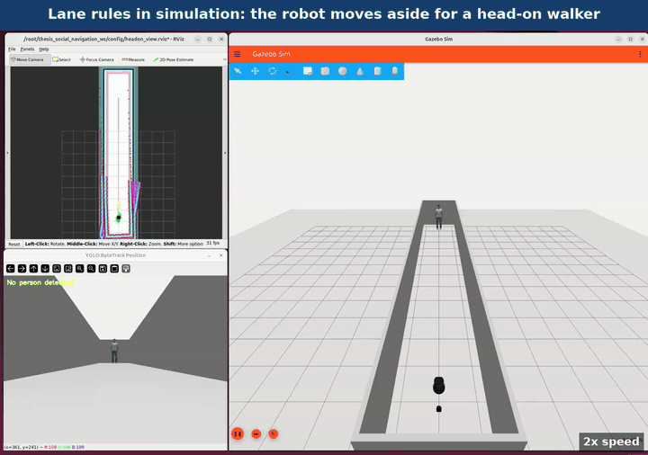
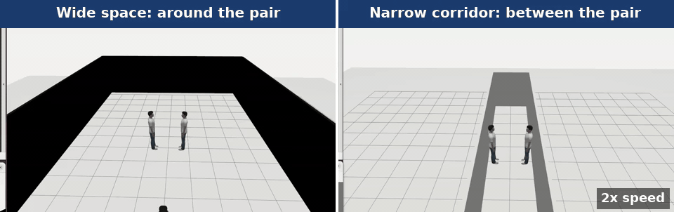

# Social Navigation for TurtleBot 4 (ROS 2 Jazzy, simulation)

Simulation code of the master's thesis *Lightweight Socially-Aware Navigation via Human Motion Prediction and Scene Understanding* (Deggendorf Institute of Technology, Campus Cham, 2026).

A TurtleBot 4 detects people with its camera and LiDAR (YOLO and ByteTrack), predicts their motion with a Kalman filter, and passes them at a social distance. Nav2's MPPI controller uses a custom critic (SocialCritic) with lane rules for a person walking towards the robot, and a group detector that tells the robot whether to go around a standing pair or pass between its members.

## Results

### Head-on walker: the robot moves aside early



*Simulation, 2.5 m corridor, walker at 1.2 m/s, played at 2x speed. This is a demonstration run of 4 October 2026 with the lane rules; the robot passed on the right at 0.74 m between centres without stopping.*

Ten trials per configuration (`ros2_ws/analysis/*_n10_report.txt`). The target is 0.8 m between the centres of robot and person.

| Configuration | Closest distance between centres (m) | Stopped (s) | Time to goal (s) | Goal reached |
|---|---|---|---|---|
| Baseline: person cloud, no lane rules | 0.08 ± 0.07 (contact) | 2.4 ± 2.5 | 42.8 ± 1.6 | 10 / 10 |
| Lane rules | 0.84 ± 0.04 | 0.0 | 37.3 ± 0.4 | 10 / 10 |
| Final configuration (as on the robot) | 0.76 ± 0.07 | 0.0 | 37.7 ± 0.4 | 10 / 10 |

### Standing pair: around in open space, between in a narrow corridor



*Simulation, played at 2x speed. Left: in open space the robot goes around the pair. Right: in a 2.0 m corridor there is no way around, so it passes between the two people without stopping. Demonstration runs of 4 October 2026 (`demo_conversation_wide_20261004_132727`, `demo_conversation_narrow_20261004_132106`), not trials of the tables.*

Final configuration in simulation, ten trials each (`ros2_ws/analysis/conv_F_rec20gs_n10_report.txt`):

| Case | Robot's path | Closest distance between centres (m) | Stopped (s) | Time to goal (s) | Goal reached |
|---|---|---|---|---|---|
| Wide (open space) | around the pair | 0.87 ± 0.03 | 0.0 | 24.6 ± 0.2 | 10 / 10 |
| Narrow (2.0 m corridor) | between the members | 0.71 ± 0.02 | 0.0 | 21.4 ± 0.2 | 10 / 10 |

How to repeat these runs: [HOW_TO_RUN.md](HOW_TO_RUN.md), section 4.

## Quick start

You need Linux with Docker and Docker Compose, an X11 display, and Intel/Mesa graphics (for other graphics, change the variables in `docker/docker-compose.yaml`).

```bash
git clone https://github.com/Brian-Lim-Tze-Zhen/Turtlebot4-Social-Navigation-Jazzy-Simulation-.git
cd Turtlebot4-Social-Navigation-Jazzy-Simulation-/docker
docker compose build && docker compose up -d
xhost +local:root

docker exec -it thesis_social_nav bash
cd /root/thesis_social_navigation_ws
source /opt/ros/jazzy/setup.bash
colcon build --symlink-install && source install/setup.bash
./run_scenario.sh headon        # or headon_blocked, conversation_wide, conversation_narrow, queue
```

To start the whole stack without a scenario, run `./run_sim.sh` and set the robot's pose with **2D Pose Estimate** in RViz before sending a goal.

The image installs ROS 2 Jazzy, Nav2, Gazebo Harmonic and the TurtleBot 4 packages; the YOLO weights are downloaded on first use.

## Documentation

| File | What it holds |
|---|---|
| [HOW_TO_RUN.md](HOW_TO_RUN.md) | folder map, set-up, and the command, recordings and report of every simulation experiment of the thesis |
| [SCENARIOS.md](SCENARIOS.md) | the five demo scenarios and what to look for |
| [docs/DEVELOPMENT_NOTES.md](docs/DEVELOPMENT_NOTES.md) | how the scenarios were built and tuned, with the runs of 24 September to 4 October 2026 |
| [docker/notes/](docker/notes/) | fixes for problems of the container (TF QoS, YOLO threads, world sync, package pins) |

## Custom Gazebo worlds/models - known issue and workaround

`turtlebot4_gz_bringup`'s launch file does not reliably resolve
`model://` URIs via `GZ_SIM_RESOURCE_PATH` for nested custom models when
Gazebo is spawned through `ros2 launch` (confirmed empirically: works for
a standalone `gz sim` call, fails under `ros2 launch` with the identical
environment). `docker/setup_gazebo_worlds.sh` works around this by
copying custom worlds/models into `turtlebot4_gz_bringup`'s own installed
`worlds/` directory at container startup, and is also called explicitly
at the top of `run_sim.sh` for non-interactive invocations.

## Attribution

The `person_standing` Gazebo model (`ros2_ws/simulation_models/`) was
created by **Marina Kollmitz** (University of Freiburg) using MakeHuman.
Not an original contribution of this thesis - included with attribution
intact per `model.config`.
