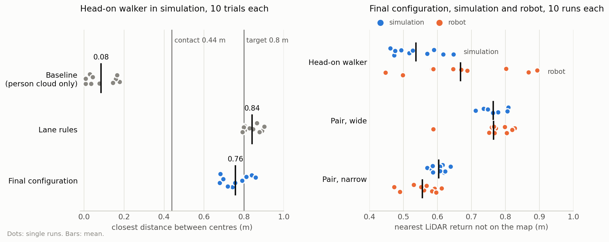

# Social Navigation for TurtleBot 4 (ROS 2 Jazzy, simulation)

Simulation code of the master's thesis *Lightweight Socially-Aware Navigation via Human Motion Prediction and Scene Understanding* (Deggendorf Institute of Technology, Campus Cham, 2026).

A TurtleBot 4 detects people with its camera and LiDAR, predicts their motion with a Kalman filter, and passes them at a social distance. Nav2's MPPI controller uses a custom critic, the SocialCritic, with lane rules for a person walking towards the robot, and a group detector tells the robot whether to go around a standing pair or pass between its members. The same system runs on the physical robot; see the [robot repository](https://github.com/Brian-Lim-Tze-Zhen/Turtlebot4-Hardware-Humble).

**Contents:** [Results](#results) · [Pipeline](#pipeline) · [Analysis](#analysis) · [Quick start](#quick-start) · [Documentation](#documentation) · [References](#references) · [Citation](#citation)

## Results

### Head-on walker: the robot moves aside early


*2.5 m corridor, walker at 1.2 m/s, played at 2x speed. A demonstration run of 4 October 2026 with the lane rules: the robot passes on the right at 0.74 m between centres without stopping.*

Ten trials per configuration ([reports](ros2_ws/analysis/)). The target is 0.8 m between the centres of robot and person.

| Configuration | Closest distance between centres (m) | Stopped (s) | Time to goal (s) | Goal reached |
|---|---|---|---|---|
| Baseline: person cloud, no lane rules | 0.08 ± 0.07 (contact) | 2.4 ± 2.5 | 42.8 ± 1.6 | 10 / 10 |
| Lane rules | 0.84 ± 0.04 | 0.0 | 37.3 ± 0.4 | 10 / 10 |
| Final configuration (as on the robot) | 0.76 ± 0.07 | 0.0 | 37.7 ± 0.4 | 10 / 10 |

### Standing pair: around in open space, between in a narrow corridor


*Played at 2x speed. Left: in open space the robot goes around the pair. Right: in a 2.0 m corridor there is no way around, so it passes between the two people without stopping. Demonstration runs of 4 October 2026, not trials of the table.*

Final configuration, ten trials each ([report](ros2_ws/analysis/conv_F_rec20gs_n10_report.txt)):

| Case | Robot's path | Closest distance between centres (m) | Stopped (s) | Time to goal (s) | Goal reached |
|---|---|---|---|---|---|
| Wide (open space) | around the pair | 0.87 ± 0.03 | 0.0 | 24.6 ± 0.2 | 10 / 10 |
| Narrow (2.0 m corridor) | between the members | 0.71 ± 0.02 | 0.0 | 21.4 ± 0.2 | 10 / 10 |

### On the real robot

The final configuration was also run on the physical TurtleBot 4, ten runs per case (thesis Section 7.6.2). The robot passed the head-on walker on the right in all ten runs, and went around the pair in the wide hallway and between the members in the narrow section in all ten, without stopping for the pair. Distances, run commands and run records are in the [robot repository](https://github.com/Brian-Lim-Tze-Zhen/Turtlebot4-Hardware-Humble).

To repeat any of these runs, see [the experiments of the thesis](HOW_TO_RUN.md#4-the-experiments-of-the-thesis).

## Pipeline


*The final configuration from the camera to the wheels (thesis Figure 5.2). Blue: existing components (sensors, detector, tracker, Nav2 and the base); orange: nodes developed in the thesis; green: the SocialCritic with the lane rules. The labelled arrows into the costmaps carry what these nodes write into them. The simulation runs the same configuration with simulation copies of the nodes, which read raw camera images and use no `/turtlebot4` namespace. The [ROS topics between the nodes](docs/CONFIGURATIONS.md#topics-of-the-final-configuration) and the [simulation and robot files side by side](docs/CONFIGURATIONS.md#simulation-vs-robot) are listed separately.*

## Analysis

<picture>
  <source media="(prefers-color-scheme: dark)" srcset="docs/media/results_dark.png">
  
</picture>

*Dots: single runs; bars: means. Left: closest distance between the centres of robot and person, from Gazebo's ground truth. Right: the measure that also works on the robot, which has no ground truth: the nearest LiDAR return that is not on the map. Data from the [simulation reports](ros2_ws/analysis/) and the robot runs of 12 October 2026; [chart script](docs/media/make_results_chart.py).*

- **Without lane rules the robot touches the walker.** The baseline's closest distance is 0.08 m between centres, far below contact at 0.44 m.
- **The lane rules move it aside early.** They reach 0.84 m. The final configuration, with the settings brought back from the robot, keeps 0.76 m.
- **The standing pair matches between simulation and robot.** Wide pair: 0.765 m in simulation, 0.766 m on the robot.
- **The head-on walker varies more on the robot.** 0.67 ± 0.15 m on the robot, against 0.54 ± 0.07 m in simulation. Narrow pair: 0.56 m on the robot, 0.60 m in simulation.

## Quick start

You need Linux with Docker and Docker Compose, an X11 display, and Intel/Mesa graphics. For an NVIDIA GPU, use `docker compose -f docker-compose.nvidia.yaml` in place of `docker compose` (needs the NVIDIA Container Toolkit).

```bash
git clone https://github.com/Brian-Lim-Tze-Zhen/Turtlebot4-Social-Navigation-Jazzy-Simulation-.git
cd Turtlebot4-Social-Navigation-Jazzy-Simulation-/docker
docker compose build && docker compose up -d
xhost +local:root

docker exec -it thesis_social_nav bash
cd /root/thesis_social_navigation_ws
source /opt/ros/jazzy/setup.bash
colcon build --symlink-install && source install/setup.bash
./run_scenario.sh headon        # or headon_blocked, conversation_wide, conversation_narrow, queue
```

To start each part yourself, one node per terminal with the pose and goal set by hand in RViz, run the [scenarios step by step](docs/MANUAL_RUN.md). `./run_sim.sh` starts the [first pipeline](ros2_ws/src/social_perception/social_perception/README.md) of the project, not the one behind the results.

The image installs ROS 2 Jazzy, Nav2, Gazebo Harmonic and the TurtleBot 4 packages; the YOLO weights are downloaded on first use.

## Documentation

In the order a new reader needs them:

| Document | What it holds |
|---|---|
| [Demo scenarios](SCENARIOS.md) | the five demo scenarios, what to look for, and what to do when a run fails |
| [Scenarios step by step](docs/MANUAL_RUN.md) | the same scenarios one node per terminal, with the pose and goal set by hand in RViz, for debugging |
| [Configurations](docs/CONFIGURATIONS.md) | what the parts of the long configuration names mean, which configuration each run uses, the ROS topics, and the simulation and robot files side by side |
| [How to run the experiments](HOW_TO_RUN.md) | folder map, set-up, and the command, recordings and report of every simulation experiment of the thesis |
| [Development notes](docs/DEVELOPMENT_NOTES.md) | how the scenarios were built and tuned, with the runs of 24 September to 4 October 2026 |
| [Container notes](docker/notes/) | fixes for problems of the container: TF recording, YOLO threads, custom Gazebo worlds, package pins |
| [Robot repository](https://github.com/Brian-Lim-Tze-Zhen/Turtlebot4-Hardware-Humble) | the robot side: final robot configuration, launch and run scripts, results on the robot |

## References

This work builds on [ROS 2](https://docs.ros.org/), [Nav2](https://github.com/ros-navigation/navigation2) and its [MPPI controller](https://github.com/ros-navigation/navigation2/tree/main/nav2_mppi_controller), the [nonpersistent voxel layer](https://github.com/SteveMacenski/nonpersistent_voxel_layer), the [TurtleBot 4 packages](https://github.com/turtlebot/turtlebot4), [Ultralytics YOLOv8](https://github.com/ultralytics/ultralytics), [ByteTrack](https://github.com/ifzhang/ByteTrack), [OpenVINO](https://github.com/openvinotoolkit/openvino) and [Gazebo](https://gazebosim.org/). It includes the `person_standing` model of Marina Kollmitz and copies of a few launch files. Authors, licenses and the matching references of the thesis: [credits and licenses](CREDITS.md).

## Citation

If you use this work, please cite the thesis:

```bibtex
@mastersthesis{limtzezhen2026socialnav,
  author = {{Brian Lim Tze Zhen}},
  title  = {Lightweight Socially-Aware Navigation via Human Motion Prediction and Scene Understanding},
  school = {Deggendorf Institute of Technology, Campus Cham},
  type   = {Master's thesis (M.Eng.)},
  year   = {2026}
}
```
