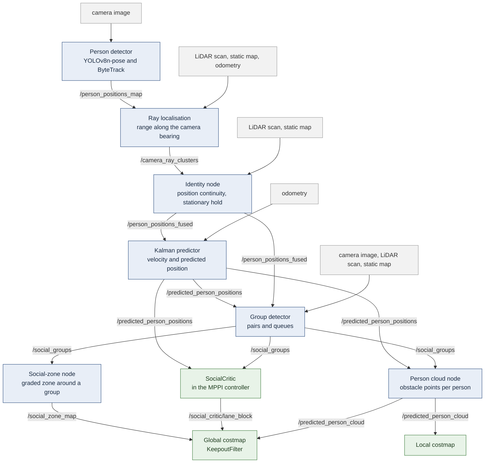

# Configurations, names, and simulation vs. robot

The file names in `ros2_ws/config/` and in the
[hardware repository](https://github.com/Brian-Lim-Tze-Zhen/Turtlebot4-Hardware-Humble)
are long, because each one adds a change to an earlier one. This page explains
the names, says which configuration each run uses, and lists what differs
between the simulation and the robot.

## Which configuration does what

| Run | Nav2 configuration (`ros2_ws/config/social_nav2_…`) | In `HOW_TO_RUN.md` |
|---|---|---|
| Demo `headon`, `headon_blocked` (`run_scenario.sh`) | `headon_F_hwreq_block_blockedhold_sim.yaml` | 4.2, "Watch-first only" |
| Demo `conversation_wide`, `conversation_narrow`, `queue` | `ablation_F_socialzone_sim.yaml` | 4.2, "Baseline (stage 3)" |
| Final configuration, compared with the robot (thesis Section 7.6) | `headon_F_hwreq_block_blockedhold_approach_hwsync_rec20_noghost_groupskip_sim.yaml` | 4.2 to 4.4, "Final configuration" |

The demos use two of the configurations compared in the thesis, **not** the
final configuration. The final one is run with
`ros2_ws/scripts/experiments/run_rec20ng_groupskip_test.sh`
(`HOW_TO_RUN.md`, section 4.4). Its robot counterpart is
`social_nav2_headon_F_hwreq_block_approach_tf05_rec20_noghost_groupskip_hw.yaml`.
Every configuration compared in the thesis is listed in `HOW_TO_RUN.md`,
sections 4.1 to 4.4.

## Reading a configuration name

A name is read from left to right; each part adds a change to the file
without it. The header of each file says what it changed and why.

| Part | Meaning |
|---|---|
| `ablation_A` … `_E` | the head-on ablation of August 2026 (`ablation_ws/`): A no social layer, B and C critic weight 20 and 10, D and E critic weight 10 and 20 with the SocialCritic on |
| `ablation_F`, `_F_` | condition F, the step after the ablation: graded social zones around detected groups (`socialzone`), as a KeepoutFilter mask on the global costmap. Every later configuration builds on it |
| `headon` | tuned for a walker coming towards the robot (the SocialCritic's lane rules) |
| `hwreq` | "hardware requirements": tuned to the real robot's perception limits (YOLO at 320 px, confidence 0.45, 8 m range), top speed 0.31 m/s, person cloud in both costmaps, no Spin or BackUp recovery |
| `block` | a keep-side block in the global costmap |
| `blockedhold` | "watch-first": no lane at first sight for standing people or people beyond the goal; the robot stands still and beeps while a person blocks it |
| `stopbeep` | an earlier stop-and-beep variant with a PersonStop zone |
| `approach` | "sustained approach": a lane starts only when the person keeps approaching (`lane_approach_window_s` 1.0, `lane_approach_min_move` 0.5) |
| `nowatch` | sustained approach without watch-first |
| `hwsync` | values ported back from the robot (transform tolerances, goal-angle threshold) and the robot's predictor, which drops a coasting track that runs into the robot |
| `pathside` | side decision from the path instead of the robot–goal line |
| `rec`, `rec15`, `rec20` | side-decision settings, side-switch offset 0.10, 0.15 and 0.20 m (`rec20` is final) |
| `noghost` | tracks that are only coasting (no fresh detection) are ignored by the occlusion slow-down (`occlusion_slow_ignore_coasted`, `coast_ghost_radius` 1.0) |
| `groupskip` | no lane for members of a detected group, so a standing pair is passed as a group |
| `tf05` | robot only: controller transform tolerance 0.5 s |
| `_sim`, `_hw` | the simulation or the robot copy |

Parts of node and launch names:

| Part | Meaning |
|---|---|
| `camray` | camera-ray perception: a YOLO detection gives a ray from the camera, matched with a LiDAR cluster for the distance |
| `lidarhold` | a group stays confirmed on LiDAR while a member is out of the camera's view |
| `_sim` (nodes) | the simulation copy of a robot node: raw camera images, simulated camera intrinsics |
| `_simport` (robot) | the robot copy of a simulation node |
| `*_used.*` (in a bag) | copy of a file as it was when the bag was recorded |

## Topics of the final configuration

The same as thesis Figure 5.2, one level down: every node with the ROS topics between them, read from the nodes and the Nav2 configuration. It is the same in simulation and on the robot (where the topics of Nav2 are under `/turtlebot4`).

Blue: perception and group nodes; grey: their inputs; green: the navigation stack. The SocialCritic reads only `/predicted_person_positions`, which carries velocity, and `/social_groups`, so that members of a standing group get no lane. The groups also reach the zone node, whose mask the global costmap's KeepoutFilter applies, and the person cloud node, which leaves group members to the zone. The SocialCritic's `/social_critic/lane_block` steers the global plan to one side. In thesis Figure 3.5 (Section 3.4), which shows the perception chain by stage, the SocialCritic first read `/person_positions_fused`; it reads `/predicted_person_positions` from Chapter 5 on.

## Simulation vs. robot

| | Simulation (this repository) | Robot (hardware repository) |
|---|---|---|
| ROS 2 | Jazzy, Gazebo Harmonic | Humble, physical TurtleBot 4 |
| Middleware | FastDDS (default; do not set `RMW_IMPLEMENTATION`), `ROS_DOMAIN_ID=0` in the trial scripts | CycloneDDS, `ROS_DOMAIN_ID=1` |
| Topics | no namespace | everything under `/turtlebot4` (nodes remap `/tf` and `/tf_static`) |
| Camera | raw `Image` | `CompressedImage` from the OAK-D |
| Distances measured from | ground truth from Gazebo | the nearest LiDAR return that is not on the map |
| Collision monitor | started by the Jazzy bring-up | added by `launch/lab2_bringup_cm.launch.py` |
| SocialCritic package | `ros2_ws/src/social_critic` | `workspace/src/social_critic_lane_noghost` |
| Time | simulation clock | the PC and the Pi must agree (chrony; see the hardware `HOW_TO_RUN.md`) |

Files of the final configuration, side by side:

| Role | Simulation (`ros2_ws/src/social_perception/social_perception/camera_lidar/`) | Robot (`humble_client/workspace/`) |
|---|---|---|
| Nav2 | `config/…_approach_hwsync_rec20_noghost_groupskip_sim.yaml` | `config/…_approach_tf05_rec20_noghost_groupskip_hw.yaml` |
| Perception launch | `launch/perception_camray_bringup_sim.launch.py` | `launch/perception_camray_lane_noghost_bringup.launch.py` |
| People detection | `yolo_leg_detector_lidar_sim.py` | `scripts/yolo_leg_detector_lidar.py` |
| Camera ray to LiDAR | `camera_ray_person_node_sim.py`, `camera_ray_identity_node_sim.py` | `scripts/camera_ray_person_node.py`, `scripts/camera_ray_identity_node.py` |
| Motion prediction | `human_kf_predictor_lidar_noghost.py` | `scripts/human_kf_predictor_lidar_noghost.py` |
| Person cloud for the costmaps | `predicted_person_cloud_node_lidar.py` | `scripts/predicted_person_cloud_node_lidar_lane.py` |
| Group detector | `social_group_detector_node_lidarhold_sim.py` | `scripts/social_group_detector_node_lidarhold.py` |
| Social-zone mask | `social_zone_costmap_node_sim.py` | `scripts/social_zone_costmap_node_simport.py` |
| Hold and beep when blocked | `blocked_person_beep_node_front_atgoal_sim.py` | `scripts/blocked_person_beep_node_front_atgoal.py` |
| Goal retry | `beep_retry_node_hwsync_sim.py` | `scripts/beep_retry_node.py` |
